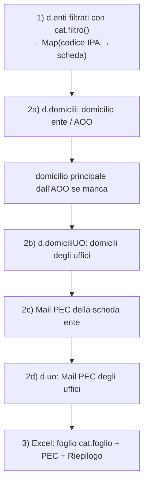
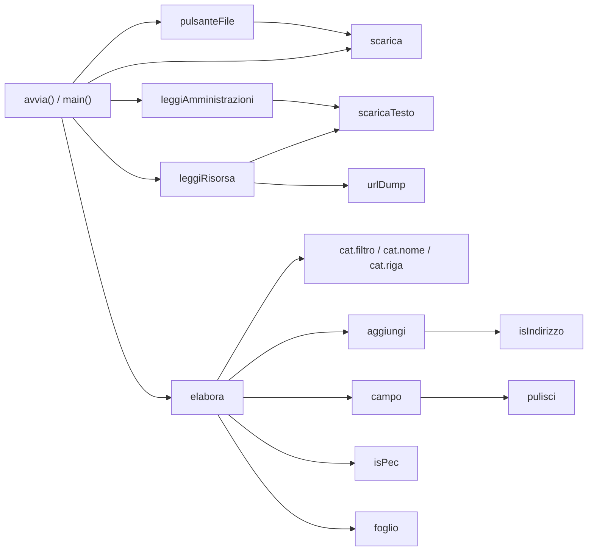

# Grafo del codice – `pec-comuni-italiani.user.js` e `scripts/estrai-pec.mjs`

Mappa del codice: serve a orientarsi senza rileggere tutto. Riferita alla **v1.1.0** (Comuni e Scuole). I numeri di riga vanno aggiornati a ogni modifica, insieme a `@version`.

I due file hanno **la stessa logica e gli stessi nomi**. Cambia solo l'ambiente: browser (download dei file) nello userscript, Node (scrittura in `dati/`) nello script per GitHub Actions.

## 1. Flusso principale

```mermaid
flowchart TD
    U([Tampermonkey: clic «Estrai PEC (Comuni e Scuole)»]) --> A["avvia()"]
    W([GitHub Actions: «Run workflow»]) --> M["main()"]
    A --> D
    M --> D
    D["Download una sola volta:<br/>leggiRisorsa('enti'), leggiAmministrazioni(),<br/>leggiRisorsa('domicili' | 'domiciliUO' | 'uo')"]
    D --> L{"per ogni voce di CATEGORIE"}
    L -->|comuni| E1["elabora(comuni, dati)"]
    L -->|scuole| E2["elabora(scuole, dati)"]
    E1 --> X1[PEC_Comuni_italiani.xlsx]
    E2 --> X2[PEC_Scuole_italiane.xlsx]
    X1 --> O1["browser: scarica() + pulsanti blu<br/>Node: dati/ + riepilogo.md + commit del bot"]
    X2 --> O1
```

## 2. Dentro `elabora(cat, d)`



## 3. Chi chiama chi



`scarica` e `pulsanteFile` esistono solo nello userscript.

## 4. Indice (numeri di riga)

| Nome | userscript | Node | Cosa fa |
|---|---:|---:|---|
| `RISORSE` | 34 | 14 | ID delle risorse Open Data IndicePA |
| `AMMINISTRAZIONI_TXT` | 40 | 20 | Percorso di `amministrazioni.txt` (provincia e regione) |
| `urlDump(id)` | 42 | 21 | URL del dump JSON CKAN |
| `log(t)` | 55 | 24 | Messaggi (riquadro o console) |
| `scarica(f)` | 57 | – | Download di un file `{blob, nome}` nel browser |
| `pulsanteFile(f, testo)` | 63 | – | Pulsante blu «Scarica …» per riscaricare un file |
| `pulisci`, `isPec`, `isIndirizzo` | 73–75 | 25–27 | Utilità sul testo |
| `campo(o, ...nomi)` | 76 | 28 | Lettura di un campo senza distinguere maiuscole e minuscole |
| `CATEGORIE` | 86 | 38 | Definizione di Comuni e Scuole: filtro, nome, colonne, file |
| `LIVELLI` | 105 | 57 | I 5 livelli di PEC |
| `scaricaTesto(url, etichetta)` | 109 | 60 | Download (browser: avanzamento in MB; Node: 3 tentativi) |
| `leggiRisorsa(chiave)` | 127 | 76 | Dump JSON CKAN → array di oggetti |
| `leggiAmministrazioni()` | 138 | 85 | `Map(cod_amm → {comune, provincia, regione})` |
| `elabora(cat, d)` | 159 | 106 | Una categoria → Excel (browser: restituisce `{blob, nome, sintesi}`; Node: scrive il file e restituisce il testo per `riepilogo.md`) |
| ↳ `aggiungi(s, r)` | 179 | 126 | Aggiunge una PEC scartando i doppioni (codice IPA + indirizzo) |
| ↳ `conta(l)` | 230 | 177 | Conteggio delle PEC per livello |
| ↳ `foglio(righe, nome, larghezze)` | 251 | 198 | Foglio Excel con larghezze e filtri |
| `avvia()` / `main()` | 271 | 221 | Scarica i dati una volta ed elabora tutte le categorie |

## 5. `CATEGORIE`: come si aggiunge un tipo di ente

Ogni voce ha: `chiave`, `titolo`, `nomeFile`, `foglio`, `etichetta`, `filtro(e)`, `nome(e, a)`, `intestazione`, `riga(s)` e `larghezze`.

| Categoria | Filtro sul dataset Enti | File |
|---|---|---|
| Comuni | `Codice_Categoria === 'L6'` e (`Codice_IPA` tipo `c_a267` oppure «Comune di …») | `PEC_Comuni_italiani.xlsx` |
| Scuole | `Codice_MIUR` presente (istituti scolastici statali) | `PEC_Scuole_italiane.xlsx` |

Per aggiungere un'altra categoria basta inserire una voce in `CATEGORIE` **in entrambi i file**. Nel workflow va aggiunto anche il nuovo file a `git add` e a `upload-artifact`.

## 6. Strutture dati

```text
d (dati scaricati una sola volta)
├─ enti[]         righe del dataset Enti
├─ amm            Map(codice IPA → {comune, provincia, regione})
├─ domicili[]     domicili digitali di ente e AOO
├─ domiciliUO[]   domicili digitali delle UO
└─ uo[]           unità organizzative (Mail1..3)

scheda (valore della Map dentro elabora, chiave = codice IPA in minuscolo)
├─ ipa, nome, cf, miur, istat, catastale, sito
├─ comune, provincia, regione
├─ domicilio      → PEC principale
├─ mailEnte[5]    → {m, t} dalla scheda Enti
└─ pec[]          → {livello, ufficio, codiceUfficio, pec, tipo, data, fonte}
```

## 7. Dipendenze esterne

| Dipendenza | Dove | Note |
|---|---|---|
| SheetJS `xlsx@0.18.5` | userscript: `@require`; Node: `npm install` nel workflow | `aoa_to_sheet`, `write` / `writeFile` |
| Open Data IndicePA (CKAN) | `fetch` | `/ipa-dati/datastore/dump/<id>?format=json` |
| `@updateURL` | GitHub raw (`main`) | aggiornamento automatico in Tampermonkey |
| `.github/workflows/estrai-pec.yml` | GitHub Actions | solo `workflow_dispatch`; commit di `dati/`; artifact 30 giorni |

## 8. Punti delicati

- **Nomi delle colonne IndicePA**: si leggono sempre con `campo()`. Se un'intestazione cambia, si aggiunge il nome nuovo come argomento in più.
- **ID delle risorse**: se IndicePA ricrea un dataset cambia l'ID, quindi si aggiorna `RISORSE`.
- **Filtro Scuole**: si basa su `Codice_MIUR`. Comprende solo gli istituti statali iscritti in IPA; le scuole paritarie in genere non ci sono.
- **Domicili UO**: nella prima estrazione reale (17/11/2026) i Comuni avevano 0 domicili a livello UO. Da verificare il nome della colonna `Codice_IPA` nel dataset «Domicili digitali delle UO».
- **Memoria**: il dataset Unità Organizzative è il più grande e viene letto per intero.
