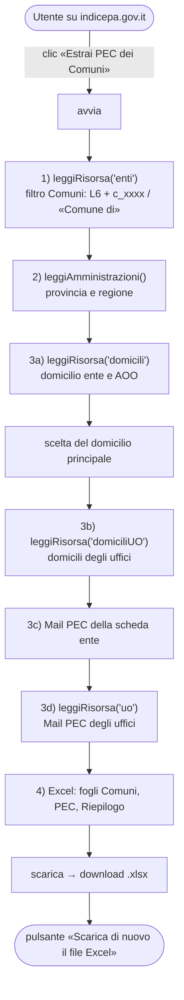
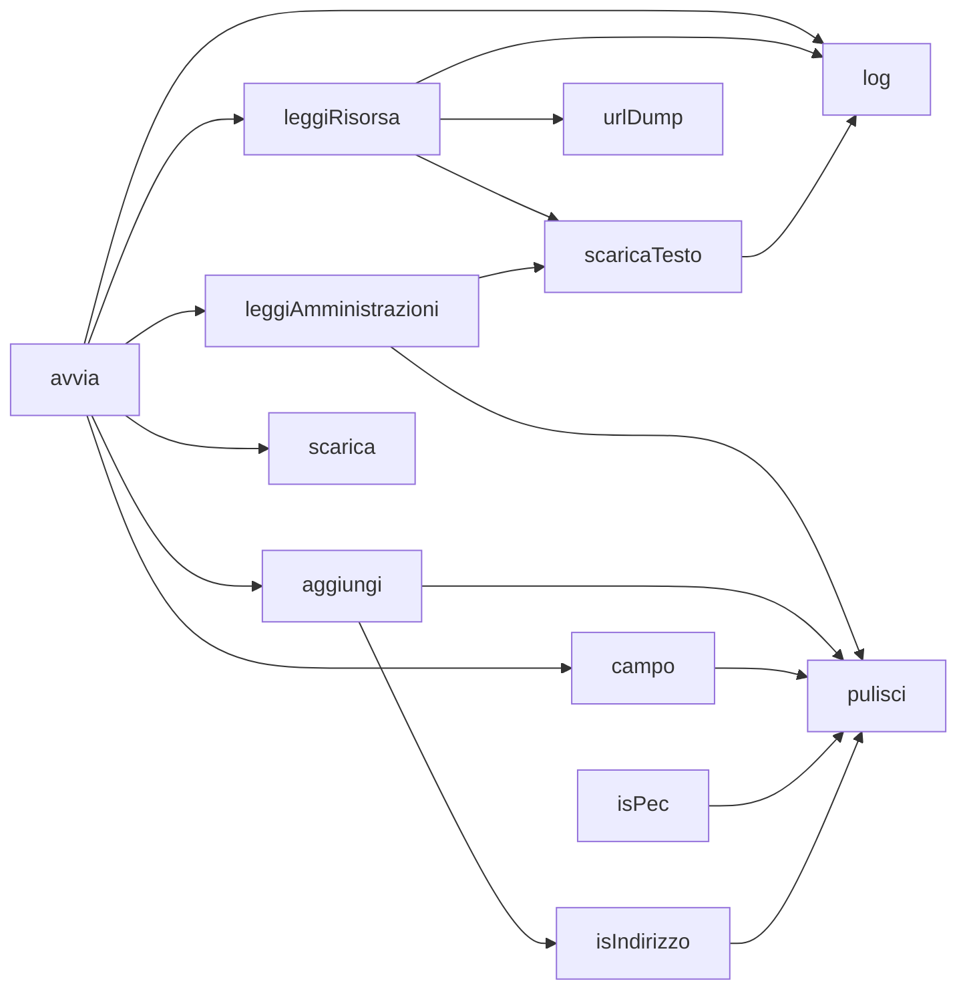

# Grafo del codice – `pec-comuni-italiani.user.js`

Mappa del codice: serve a orientarsi senza rileggere tutto il file. Riferita alla **v1.0.0**. I numeri di riga vanno aggiornati a ogni modifica, insieme a `@version`.

## 1. Flusso principale



## 2. Chi chiama chi



## 3. Indice delle funzioni

| Riga | Nome | Tipo | Cosa fa |
|---:|---|---|---|
| 35 | `RISORSE` | costante | ID delle risorse Open Data IndicePA (enti, domicili, domiciliUO, uo) |
| 41 | `AMMINISTRAZIONI_TXT` | costante | Percorso di `amministrazioni.txt` (provincia e regione) |
| 42 | `urlDump(id)` | funzione | URL del dump JSON CKAN di una risorsa |
| 44–58 | interfaccia | blocco | Riquadro fisso, pulsanti, `log()` |
| 60 | `scarica(f)` | funzione | Avvia il download di un Blob (`{blob, nome}`) |
| 70 | `pulisci(s)` | utilità | Spazi normalizzati, `null` → `''` |
| 71 | `isPec(tipo)` | utilità | Vero se il tipo di mail indica una PEC |
| 72 | `isIndirizzo(s)` | utilità | Controllo minimo di formato e-mail |
| 75 | `scaricaTesto(url, etichetta)` | async | Download con avanzamento in MB |
| 93 | `leggiRisorsa(chiave)` | async | Dump JSON CKAN → array di oggetti |
| 105 | `campo(o, ...nomi)` | utilità | Lettura di un campo senza distinguere maiuscole e minuscole |
| 115 | `leggiAmministrazioni()` | async | `amministrazioni.txt` → `Map(cod_amm → {comune, provincia, regione})`; se fallisce restituisce una mappa vuota |
| 139 | `avvia()` | async | Procedura completa, passi 1–4 |
| 172 | `aggiungi(c, r)` | interna ad `avvia` | Aggiunge una PEC al comune scartando i doppioni (codice IPA + indirizzo) |
| 237 | `conta(l)` | interna ad `avvia` | Conteggio delle PEC per livello (Riepilogo) |
| 258 | `foglio(righe, nome, larghezze)` | interna ad `avvia` | Crea un foglio Excel con larghezze e filtri |

## 4. Passi di `avvia()`

| Riga | Passo | Dati in ingresso | Risultato |
|---:|---|---|---|
| 143 | 1) Enti | dataset Enti | `comuni: Map(ipa → scheda)` |
| 163 | 2) Provincia e regione | `amministrazioni.txt` | `scheda.provincia`, `scheda.regione` |
| 181 | 3a) Domicili ente/AOO | dataset Domicili digitali | `scheda.pec[]`, `scheda.domicilio` |
| 192 | Domicilio principale | AOO già raccolte | `scheda.domicilio` se mancava |
| 200 | 3b) Domicili UO | dataset Domicili digitali delle UO | `scheda.pec[]` |
| 208 | 3c) PEC dell'ente | campi `Mail1..5` di Enti | `scheda.pec[]`, ultimo ripiego per `domicilio` |
| 214 | 3d) PEC degli uffici | dataset Unità Organizzative (`Mail1..3`) | `scheda.pec[]` |
| 225 | 4) Excel | `comuni` | file `PEC_Comuni_italiani_<data>.xlsx` |

## 5. Strutture dati

```text
scheda comune (valore della Map «comuni», chiave = codice IPA in minuscolo)
├─ ipa, denominazione, cf, istat, catastale, sito
├─ comune, provincia, regione
├─ domicilio            → PEC principale (stringa)
├─ mailEnte[5]          → {m: indirizzo, t: tipo} dalla scheda Enti
└─ pec[]                → {livello, ufficio, codiceUfficio, pec, tipo, data, fonte}

livello ∈ { 'Ente – domicilio digitale', 'AOO – domicilio digitale',
            'UO – domicilio digitale', 'Ente – casella PEC', 'UO – casella PEC' }
```

## 6. Dipendenze esterne

| Dipendenza | Dove | Note |
|---|---|---|
| SheetJS `xlsx@0.18.5` | `@require` (jsDelivr) | `XLSX.utils.aoa_to_sheet`, `XLSX.write` |
| Open Data IndicePA (CKAN) | `fetch` stessa origine | `/ipa-dati/datastore/dump/<id>?format=json` |
| `@updateURL` | GitHub raw (`main`) | aggiornamento automatico in Tampermonkey |

## 7. Punti delicati (dove intervenire se qualcosa si rompe)

- **Nomi delle colonne IndicePA**: si leggono sempre con `campo()`. Se cambia un'intestazione, basta aggiungere il nome nuovo come secondo argomento, es. `campo(d, 'Descrizione_uo', 'Descrizione_ufficio')`.
- **ID delle risorse**: se IndicePA ricrea un dataset cambia l'ID, quindi si aggiorna `RISORSE` (riga 35).
- **Filtro dei Comuni** (riga 150): `L6` comprende anche unioni e consorzi, che vengono esclusi dalla regola sul codice IPA / denominazione.
- **Memoria**: il dataset Unità Organizzative è il più grande; viene letto per intero in memoria.
